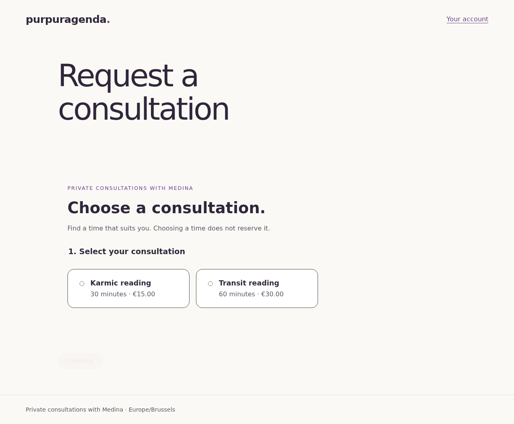
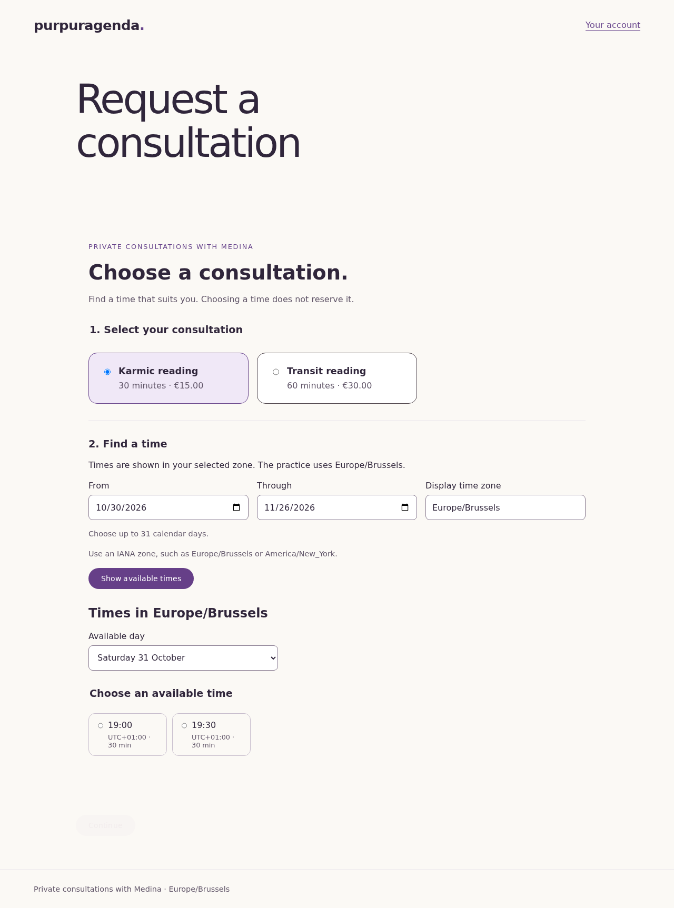
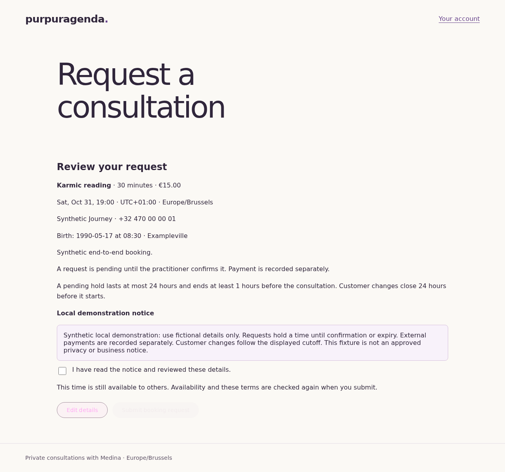
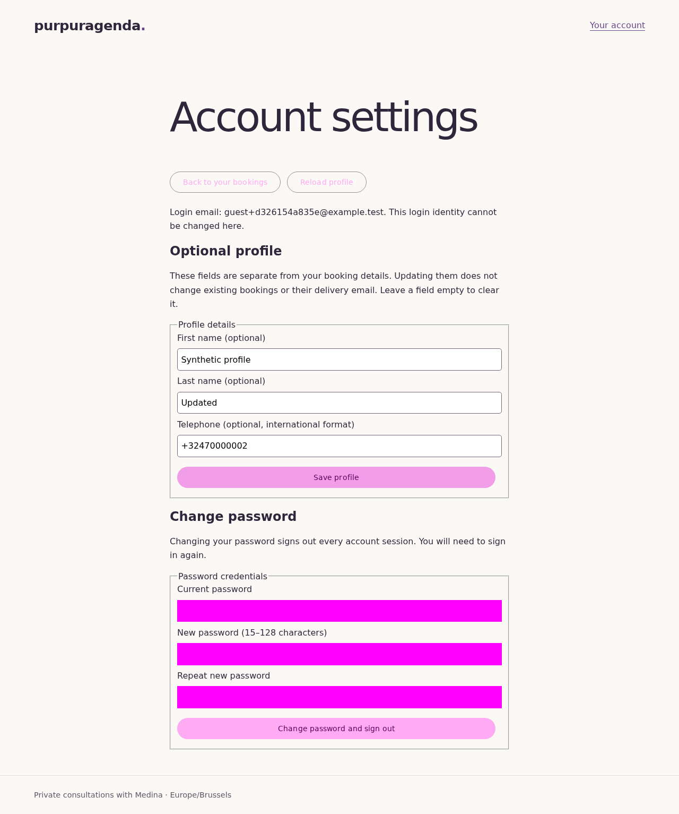
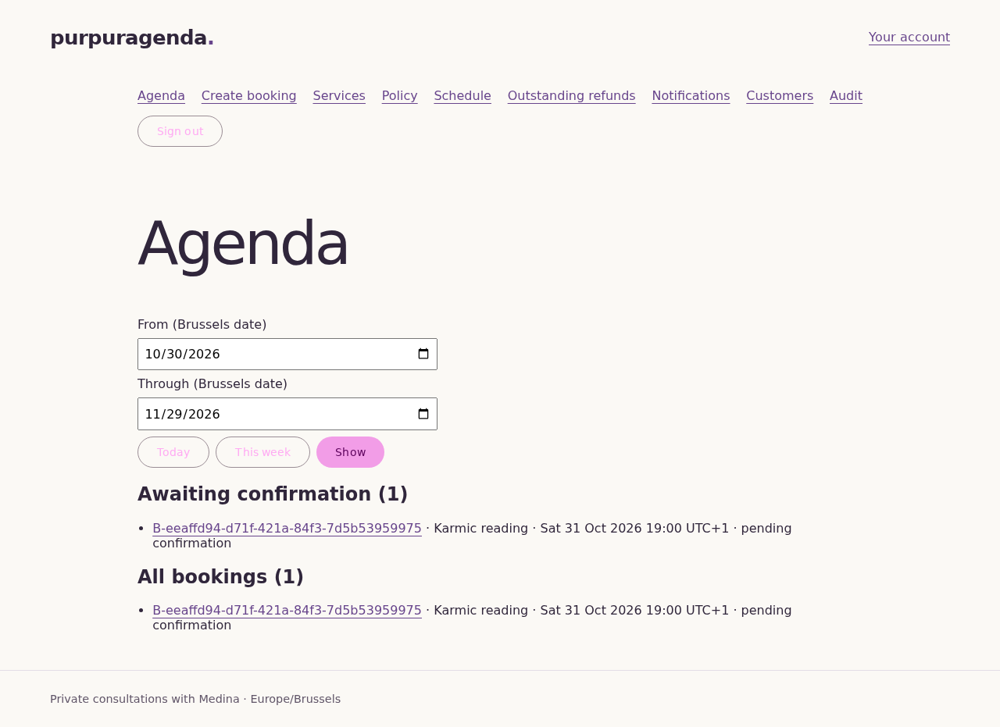
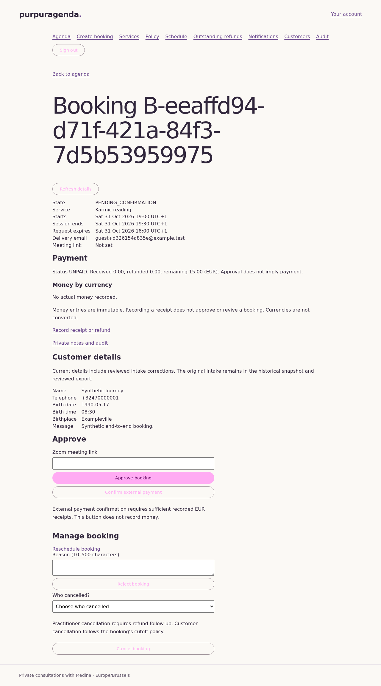
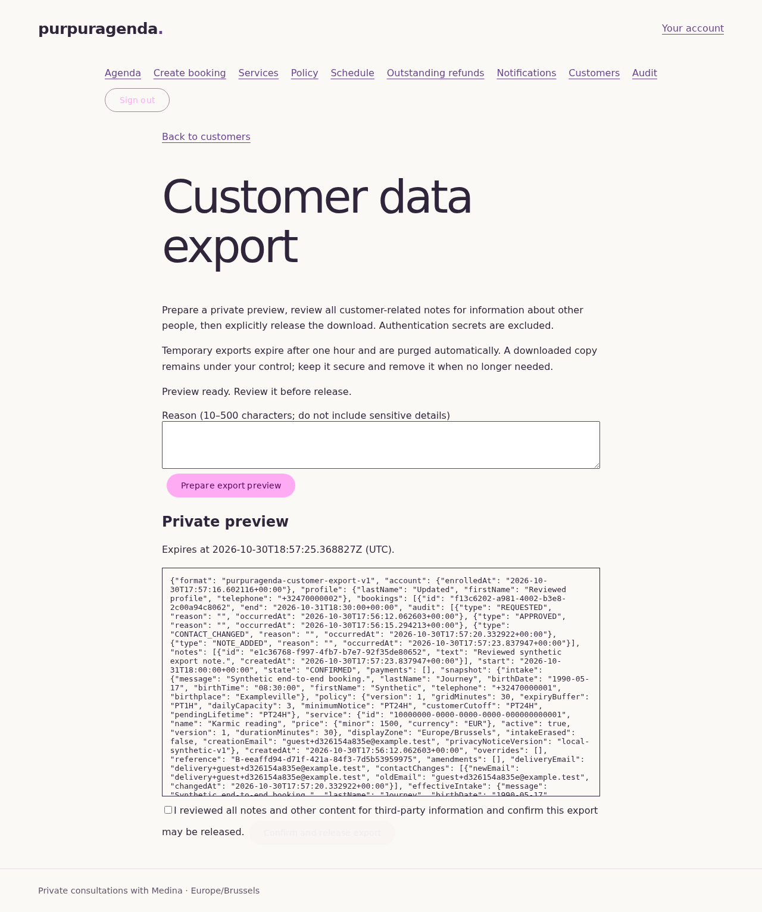
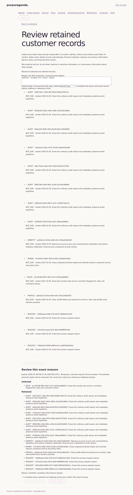

# Purpuragenda — user's manual


Purpuragenda helps one practitioner manage consultation requests, manually arranged Zoom meetings and external payment records. Customers can book without an account; the administrator reviews requests and manages the schedule. The interface is in English.

This manual describes the current local development version, including reviewed privacy operations. It does not announce a new release. [STATUS.md](STATUS.md) records merged work, verification and remaining release requirements.

The screenshots below are actual browser captures of the application with synthetic demonstration data. Example names, email addresses, dates, references and amounts are not real customer information. Your available times and bookings will differ.

## Find your way

- [Start the application](#start-the-application)
- [Request a consultation](#request-a-consultation)
- [Manage a booking](#manage-a-booking)
- [Use an optional customer account](#use-an-optional-customer-account)
- [Administrator: review and manage bookings](#administrator-review-and-manage-bookings)
- [Record receipts and refunds](#record-receipts-and-refunds)
- [Manage services and availability](#manage-services-and-availability)
- [Customer records and privacy](#customer-records-and-privacy)
- [Troubleshooting](#troubleshooting)
- [Operator and developer reference](#operator-and-developer-reference)

## Start the application

You need Docker Desktop on macOS or Windows with WSL2 integration, or Docker Engine with Compose v2 on Linux. You also need bash, git and Python 3.9 or newer. Keep ports 8080 and 8025 free.

From the repository folder:

```sh
./purpuragenda.sh doctor
./purpuragenda.sh setup
./purpuragenda.sh up
```

Open the application at **http://localhost:8080**. Use `localhost`, rather than `127.0.0.1`, so browser session and origin checks match.

For the local stack, every email goes to **Mailpit at http://localhost:8025**. Open verification and booking messages there as you would in an inbox. Local mode does not send live customer email.

The first administrator must be enrolled privately:

```sh
./purpuragenda.sh admin
```

Follow the terminal prompts for the administrator email, password and authenticator setup. Keep the recovery material private. There is no public administrator registration page. Then sign in at http://localhost:8080/admin/login.

To stop the application while keeping bookings and keys:

```sh
./purpuragenda.sh down
```

Never run `docker compose down -v` and never delete `./.secrets` or the persistent privacy journal. The stored data and encryption keys belong together.

## Request a consultation

### 1. Choose a service and time

Open http://localhost:8080/book. Choose a consultation, select a date range and press **Show available times**.



Pick an available time, check **Your selection**, and press **Continue**. Selecting a time does not reserve it; availability is checked again when the request is submitted.



The practitioner operates on Europe/Brussels dates. Where the page offers a display time zone, check the displayed zone and offset before choosing a time, especially around daylight-saving changes.

### 2. Verify your email

Enter your email under **Verify your email**, then press **Send verification link**. Open the message in Mailpit, follow its link in the browser that requested it, and press **Verify email**.

Return to the booking page and press **I have verified my email**. Links expire and can be used only once; request another if needed.

### 3. Enter and review your details

Enter the requested contact and birth details, with an optional message. Birth date and time are taken as entered; the application does not infer a birth time zone.

Use this application for non-medical information only. Do not include medical or other sensitive information, or unnecessary details about other people.

Press **Review request**, check the service, time, details and booking terms, tick the agreement, then press **Submit booking request**.



The **Your booking** page shows a booking reference and a pending status. Keep the reference. A request is confirmed only after the practitioner approves it; pending requests expire if their hold ends first.

If the response is uncertain, use the page's retry action for the same submission. Starting another request can create a separate booking.

## Manage a booking

Open http://localhost:8080/manage. Enter the booking reference and the original verified email, then open the management message in the requesting browser.

The booking page shows the service, time and status. Once confirmed, it also provides **Open meeting link** for the manually entered Zoom meeting.

| Action | What to do |
| --- | --- |
| Check progress | Choose **Refresh booking status**. A pending request is not yet an appointment confirmation. |
| Cancel | Choose **Cancel this booking**, then **Yes, cancel this booking**. Choose **Keep my booking** to go back. |
| Move the appointment | Choose **Change time**, select an available replacement and review the change before confirming. |
| Change the delivery email | Use the booking's verified delivery-contact change flow. Verify the new address before confirming the change. |

Customer changes are available only while the booking's policy permits them. The booking page explains the applicable cutoff. A delivery-address change does not transfer ownership or change an account's login email.

Keep the original login/ownership email available even after changing where booking updates are delivered.

## Use an optional customer account

An account is optional. A guest booking does not create one automatically.

From the account entry page, request an account link for the verified email, open it in the same browser, and explicitly choose a password. Then sign in at http://localhost:8080/account/login.

The account area shows bookings belonging to that original verified identity. Open a booking from the history to manage it. In **Account settings**, you can save an optional profile or change the password.



Profile changes do not rewrite details already captured in a booking. A password change signs out account sessions; sign in again with the new password. Changing delivery contact on one booking does not change the account's login email.

## Administrator: review and manage bookings

### Sign in and find a request

Open http://localhost:8080/admin/login and enter the administrator email, password and current authenticator code. If the application requests fresh authentication for a protected action, sign in again and return to that workflow. Private drafts may need to be re-entered.

The **Agenda** provides a date-range view and a separate pending queue. Use **Today**, **This week**, or a range of at most 31 Brussels dates, then press **Show**. Use **Load more** where offered.



### Review and approve

Open a booking by its reference. Check its service, time, customer details, payment summary and current state.



Arrange the Zoom meeting yourself, paste its HTTPS `zoom.us` participant link into **Zoom meeting link**, and choose **Approve booking**. The application does not provision Zoom meetings automatically.

**Approval does not record payment.** Use **Confirm external payment** only when sufficient external receipts have already been recorded. See [receipts and refunds](#record-receipts-and-refunds).

A request must still have a live hold and a future appointment time. Confirmation sends a booking update through the configured delivery channel; in local mode, read it in Mailpit.

### Other booking actions

| Task | Where and how |
| --- | --- |
| Create a booking manually | Use the administrator's new-booking page. Select the service and time, enter the details, review, then create. Leave the meeting link empty for a pending request, or supply a valid link for a confirmed booking. |
| Reject or cancel | Open the booking and enter a reason. For cancellation, choose who cancelled; the classification affects refund follow-up. |
| Reschedule | Open **Reschedule booking**, choose a replacement and review the change. Explicit overrides require their own reason and acknowledgments. |
| Change a meeting link | Enter a replacement Zoom participant link on an eligible booking. |
| Record an outcome | Choose **Mark completed** or **Mark no-show** after the session starts. An early outcome needs a reason. |
| Add a private note | Open **Private notes and audit**, enter the note and choose **Add private note**. Adding a note does not email the customer. |

An override never permits overlapping 120-minute reservations. Service/session duration and the reserved scheduling interval can differ.

## Record receipts and refunds

From the booking detail, choose **Record receipt or refund** to open **Receipts and refunds**.

1. Choose **Record money received**, **Record money refunded**, or **Require a refund**.
2. For an actual receipt or refund, enter the exact amount, currency where applicable, payment method, external transaction reference and verified Brussels date/time.
3. For a refund, select the original receipt. Refunds use that receipt's currency. For a refund requirement, select the receipt and give a reason.
4. Review the facts and choose **Record actual money** or **Record refund requirement**.

These actions record money already moved outside Purpuragenda. They do not charge a card, send a bank transfer or return funds automatically. Enter decimal amounts without grouping or rounding. If a Brussels time occurs twice during the autumn clock change, select the correct offset.

Use **Outstanding refunds** to find remaining refund obligations. A manually approved booking may still be unpaid; booking state and payment facts are independent.

## Manage services and availability

Use the administrator navigation for these settings:

| Page | Use it for |
| --- | --- |
| **Services** | Create or edit the name, duration and price; archive a service or restore it. Existing booking snapshots keep their original service facts. |
| **Schedule and blackouts** | Edit weekly windows, date exceptions and blackout intervals. |
| **Booking policy** | Review scheduling limits and notice, hold, expiry and customer-change rules. |

For schedule or policy changes, choose **Preview affected bookings**, review the conflicts and acknowledgments, then use **Save reviewed calendar change** or **Save reviewed policy**. A preview is a review step, not a saved change.

**Schedule and blackouts** manages bookable availability. Private iCalendar downloads and Google Calendar actions remain separate planned work; do not assume a calendar has been synchronized.

Under **Notification follow-up**, review the current status before requesting a retry. A reasoned retry queues work; the delivery worker still checks whether the message is relevant. Local messages remain in Mailpit, and restore mode keeps delivery suppressed.

## Customer records and privacy

Open **Customers**, search by name, email or booking reference, and choose **View bookings for …**. The original verified identity remains the owner even if a booking's delivery email changes.

Private notes can be included in a customer export after review. Keep messages, notes and reasons relevant and free of medical or other sensitive information.

### Export a customer's records

1. Open **Customer data export** and enter a reason without personal details.
2. Choose **Prepare export preview**.
3. Review all included records, especially private notes and information about other people.
4. Tick the review confirmation and choose **Confirm and release export**.
5. Choose **Prepare secure download**, then **Save reviewed customer export**.



The temporary snapshot expires after one hour. Preparing, viewing, releasing and downloading require current administrator authority and fresh MFA. A downloaded file remains the operator's responsibility; the application cannot recall copies already saved elsewhere.

### Correct a record

Choose **Correct profile**, **Correct intake**, or **Correct private notes** for the exact customer or booking. Select the note when necessary. Edit the fields, give a reason and choose **Prepare correction preview**. Compare Before and After, tick the confirmation and choose **Confirm correction**.

If the record changed while you were reviewing, prepare a new preview. A confirmed correction revokes existing temporary exports. Profile and note values are replaced; intake amendments appear as current details while the original intake stays historical. Corrections do not change verified identity, ownership, service/policy snapshots or payment facts.

### Review retention, holds and erasure

Open **Review retention and erasure** from the customer's bookings.

- Intake and private notes prompt review after 12 months.
- Identity, identifiable history and ordinary audit prompt review after 24 months.
- Dates prompt administrator review; they never delete records automatically.
- Financial records cannot be selected for erasure. The proposed financial retention period still requires accounting confirmation.

To retain a specific record, enter a reason, optionally set an inclusive Brussels end date, tick the exact-record hold acknowledgment and choose **Hold this record**. Release an existing hold only after reviewing the reason and exact record. A hold on one record does not automatically hold all customer data.

To erase selected personal copies:

1. Tick the exact records. Held and financial records cannot be selected.
2. Enter a reason and choose **Prepare erasure preview**.
3. Review both **Selected** and **Retained**, including each effect.
4. Tick the explicit confirmation, then choose **Confirm reviewed erasure**.



The preview expires after one hour and confirmation requires fresh MFA. Erasure invalidates temporary exports and old retries that could restore selected content. Financial amounts and relationships and immutable service/policy facts remain. Erased personal fields are displayed explicitly.

If erasure is interrupted, ordinary application access is blocked. Do not remove the barrier or delete the journal. Use the same confirmation retry where available, or have the operator follow the [private restore/reconciliation procedure](docs/privacy.md#reviewed-erasure-and-restore-journal). Restoring an older database does not undo an approved erasure.

## Troubleshooting

| What you see | Next step |
| --- | --- |
| The application does not open | Use `http://localhost:8080`, then run `./purpuragenda.sh status` and `./purpuragenda.sh smoke`. |
| No verification or booking email | Check Mailpit at `http://localhost:8025`. Local mode does not deliver to a real inbox. |
| A link is expired or already used | Request a fresh link and open it in the browser that requested it. |
| A selected time is no longer available | Refresh availability and choose another time. Selection alone does not reserve a slot. |
| A change is no longer allowed | Check the booking's state, expiry and customer-change cutoff. Contact the practitioner if needed. |
| An authenticator code is rejected | Check the device clock and try a fresh code. Use the private recovery procedure if the factor is unavailable. |
| The result of a submission is uncertain | Use the page's same-request retry. Do not start another operation until the result is known. |
| A privacy preview is unavailable or stale | Return to Customers, prepare a fresh preview and review it again. |
| Access is blocked after interrupted erasure or restore | Preserve volumes, keys and journal. Ask the operator to reconcile and replay before releasing access. |

## Operator and developer reference

The local stack uses Java 25, PostgreSQL, Angular, Docker Compose, Caddy and Mailpit. Deployment, public ingress, purchases and live customer communication remain separate manual decisions. The current local development branch is not evidence of public-use readiness.

```sh
./purpuragenda.sh demo-seed   # optional synthetic bookings through the real API
./purpuragenda.sh smoke      # check the running stack
./purpuragenda.sh status     # show container state
./purpuragenda.sh logs       # inspect the supported service logs
./purpuragenda.sh help       # list commands; help <command> gives details
./purpuragenda.sh test       # frontend and Python checks
./purpuragenda.sh verify     # checks supported by this host; not release evidence
./verify.sh all              # every implemented category; missing dependencies fail
./purpuragenda.sh e2e        # browser journey on a separate isolated local stack
```

CI runs every implemented category for each PR. Coverage remains at least 90% lines and branches per backend module and Angular, with 95% lines for domain and application. A screenshot does not replace browser, privacy, restore or release verification.

Further reading: [text-only user guide](docs/user-manual.md), [local testing](docs/local-testing.md), [privacy and restore journal](docs/privacy.md), [administrator recovery](docs/admin-recovery.md), [delivery rules](docs/delivery.md), and [agent instructions](AGENTS.md).
